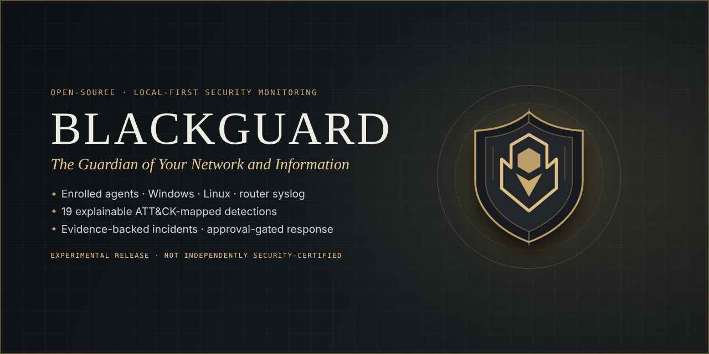
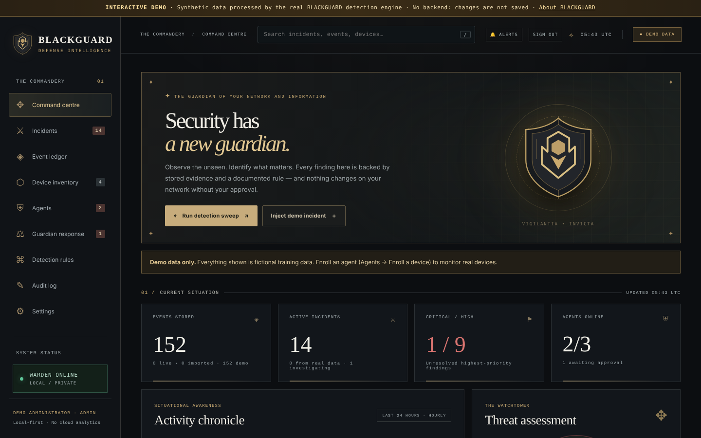
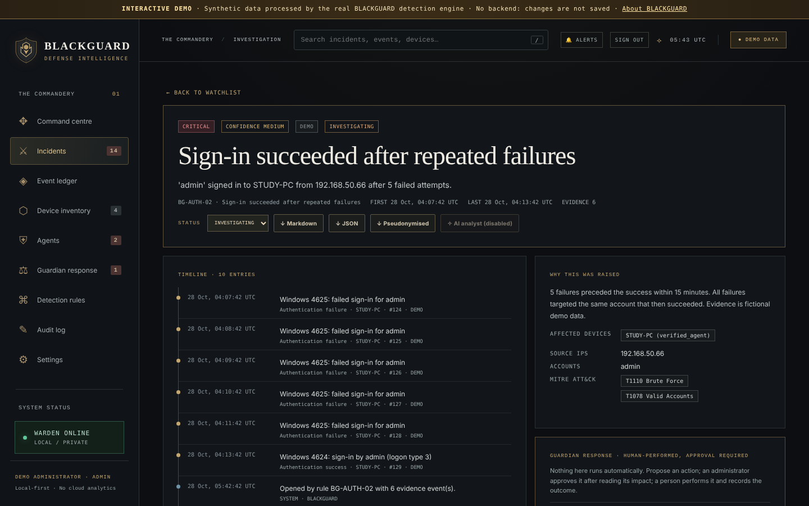
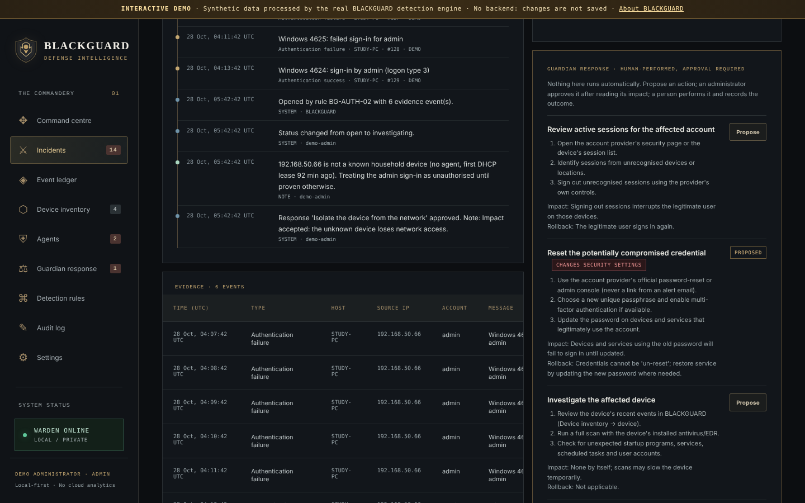
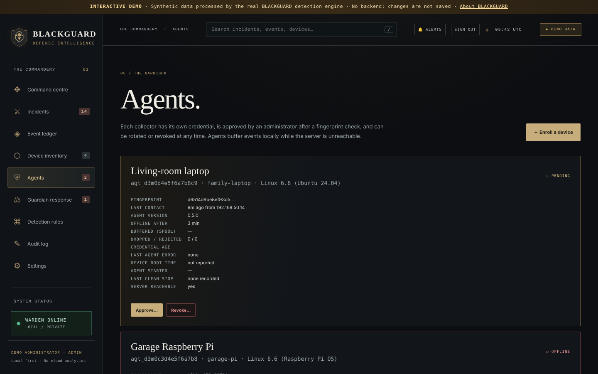
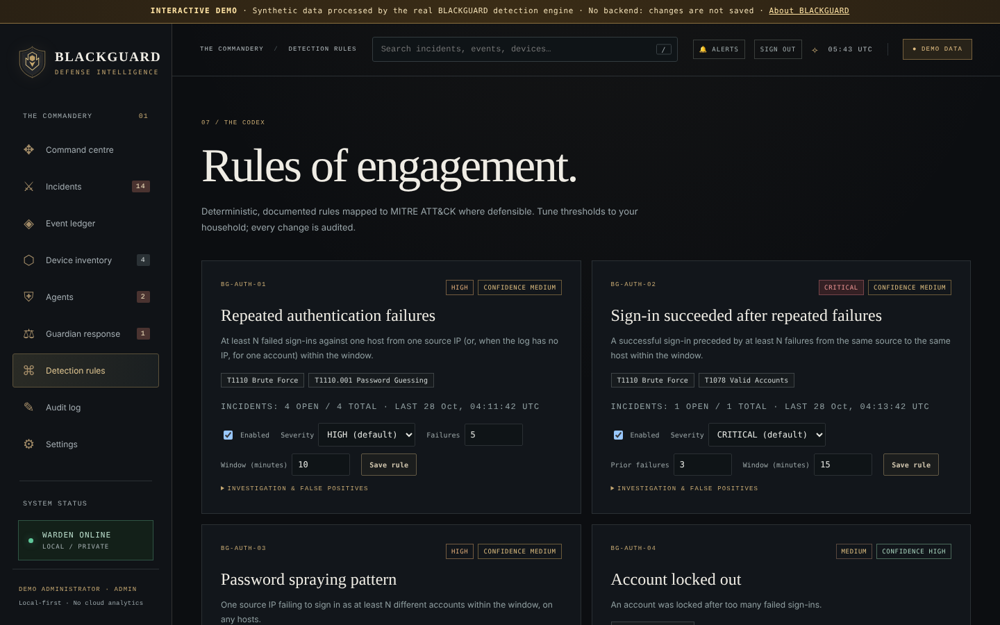
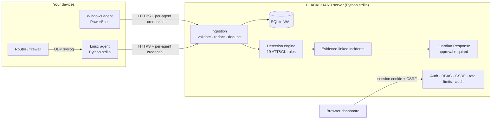

<p align="center">
  
</p>

<p align="center">
  <strong>Open-source, local-first security monitoring with explainable detections and approval-gated response.</strong><br>
  <sub>Python (stdlib only) · SQLite · vanilla JS · Windows / Linux / router agents · MIT · <b>experimental: not independently security-certified</b></sub><br>
  <sub>Created by <b>Nima Memarahari</b> (<a href="https://github.com/NimaMema">@NimaMema</a>)</sub>
</p>

---

## In 30 seconds

BLACKGUARD watches the computers and network equipment **you own**. Agents you explicitly enroll and approve collect Windows, Linux and router security events. A transparent detection engine turns those events into **evidence-backed incidents** mapped to MITRE ATT&CK, and **Guardian Response** proposes defensive actions that never run without an administrator's approval. Everything runs on your own machine, with no cloud services and no paid APIs.

| | |
| --- | --- |
| **Try it, no install** | Open [`showcase/index.html`](showcase/index.html) and choose *Launch the interactive demo*. It runs the real dashboard in your browser on **synthetic** data that was processed by the real detection engine. Locally: `python3 -m http.server -d showcase 8080` |
| **Run it for real** | `cd blackguard && python3 start.py`: Python 3.10+, nothing to install (see [Quick start](#quick-start)) |
| **Read how it works** | [How BLACKGUARD works](blackguard/docs/HOW_IT_WORKS.md): the event pipeline, agents, authentication, detection engine and incident lifecycle |

<p align="center">
  
</p>

## What it does today

| Observe | Detect | Defend |
| --- | --- | --- |
| Per-device agents for **Windows** (Security/System logs), **Linux** (auth.log, journald) and **router/firewall syslog** (netfilter, UFW, pfSense/OPNsense, OpenWrt, MikroTik, DHCP) | **19 deterministic rules** mapped to MITRE ATT&CK: brute force, password spraying, success-after-failures, backdoor accounts, privileged-group changes, log clearing, port scans, cross-device correlation, new devices | **Guardian Response**: each proposed action states its impact and rollback plan, an admin approves it, a person performs it, and every step is audited. **No automatic blocking. No counter-attacks.** |
| Durable on-device buffering; events are delivered **exactly once** across outages ([tested](blackguard/docs/RELIABILITY.md)) | Every incident explains its **confidence**, evidence, timeline, affected devices, investigation steps and false-positive considerations | Investigation workspace, notes, status history, Markdown/JSON/**pseudonymised** reports |
| Device inventory that labels each attribute *confirmed*, *reported* or *inferred*. It never scans your network | Outage causes are told apart: device rebooted, agent stopped, or server unreachable | Hash-chained, tamper-evident audit log |

<table>
<tr>
<td width="50%"><br><sub>Investigation workspace: evidence, reasoning, ATT&CK</sub></td>
<td width="50%"><br><sub>Guardian Response: approval-gated, audited</sub></td>
</tr>
<tr>
<td><br><sub>Agents: enrollment, health, credential rotation</sub></td>
<td><br><sub>Detection rules: transparent and tunable</sub></td>
</tr>
</table>

<sub>All screenshots show synthetic demo data. A 50-second walkthrough recording is in [`blackguard/docs/media/blackguard-demo.webm`](blackguard/docs/media/blackguard-demo.webm).</sub>

## Architecture



More detail: [Architecture](blackguard/docs/ARCHITECTURE.md) · [How it works](blackguard/docs/HOW_IT_WORKS.md) · [Detection rules](blackguard/docs/DETECTIONS.md) · [Reliability guarantees](blackguard/docs/RELIABILITY.md)

## Quick start

```bash
git clone https://github.com/NimaMema/blackguard-platform
cd blackguard-platform/blackguard
python3 start.py
```

Open <http://127.0.0.1:8000> and enter the **one-time setup code** printed in the terminal to create your administrator. The first run includes clearly labelled **demo data**, and a checklist guides you through enrolling your first agent, making a verified backup, and removing the demo data.

- **Windows:** `python start.py` works the same way; `deploy\windows\Install-BlackguardServer.ps1` runs it in the background. Monitor the PC with `agents\windows\BlackguardAgent.ps1 -Enroll …`.
- **Linux agent:** `python3 agents/blackguard_agent.py enroll --server … --code …`, then `run --source linux-auth:/var/log/auth.log`.
- **Docker:** `docker compose up --build` (loopback only, non-root, read-only filesystem).
- Full guide: [Deployment](blackguard/docs/DEPLOYMENT.md). Product README: [blackguard/README.md](blackguard/README.md).

## Security model (summary)

- Individual accounts, admin/analyst/viewer roles, scrypt password hashing, HttpOnly SameSite=Strict sessions, CSRF tokens, lockout and rate limiting.
- Agents enroll with a one-time code, wait for **admin approval after a fingerprint check**, and authenticate with their own hashed credential. Identity comes from the credential, so one agent cannot impersonate another.
- Strict Content-Security-Policy, no `innerHTML`, parameterised SQL, bounded request sizes, and TLS required for any non-loopback bind.
- Secrets are redacted before storage, raw logs are off by default, backups are verified, and retention never deletes open-incident evidence.

Read [SECURITY.md](SECURITY.md) to report a vulnerability, and [the security model](blackguard/docs/SECURITY.md) for controls and known risks.

## Quality

| Check | Where |
| --- | --- |
| 115 Python tests: API, authentication/RBAC, agent enrollment and revocation, ingestion and dedup, chaos delivery across server restarts, migrations, TLS, realistic attack and benign datasets, demo honesty | `blackguard/tests/` |
| Browser E2E against the real server **and** the static showcase, with **axe-core WCAG 2.2 A/AA** checks on every view | `blackguard/tests/e2e/` |
| CI: Python 3.10/3.12/3.13, bandit, secret scan, Docker build and clean-stop check, Windows parse plus server smoke test | `.github/workflows/ci.yml` |

## Honest maturity

BLACKGUARD is an **experimental** project. It has **not** been independently security-reviewed, penetration-tested or certified, and it is **not** a replacement for antivirus/EDR or a commercial SIEM. Detections are leads for a human to verify, not proof of compromise. It is used on a real Windows home setup by its author. Known limitations are listed in [SECURITY.md](blackguard/docs/SECURITY.md#known-limitations-and-remaining-risks) and [TESTING.md](blackguard/docs/TESTING.md); planned work is in the [roadmap](blackguard/docs/ROADMAP.md) and [production-readiness plan](blackguard/docs/PRODUCTION_READINESS.md).

## Contributing, license and credits

- Contributions are welcome. Read [CONTRIBUTING.md](CONTRIBUTING.md) and the [Code of Conduct](CODE_OF_CONDUCT.md).
- [MIT License](LICENSE). Runtime dependencies: none. Test-only tooling and its licences: [LICENSING.md](blackguard/docs/LICENSING.md).
- Created and maintained by **Nima Memarahari** ([@NimaMema](https://github.com/NimaMema)).
