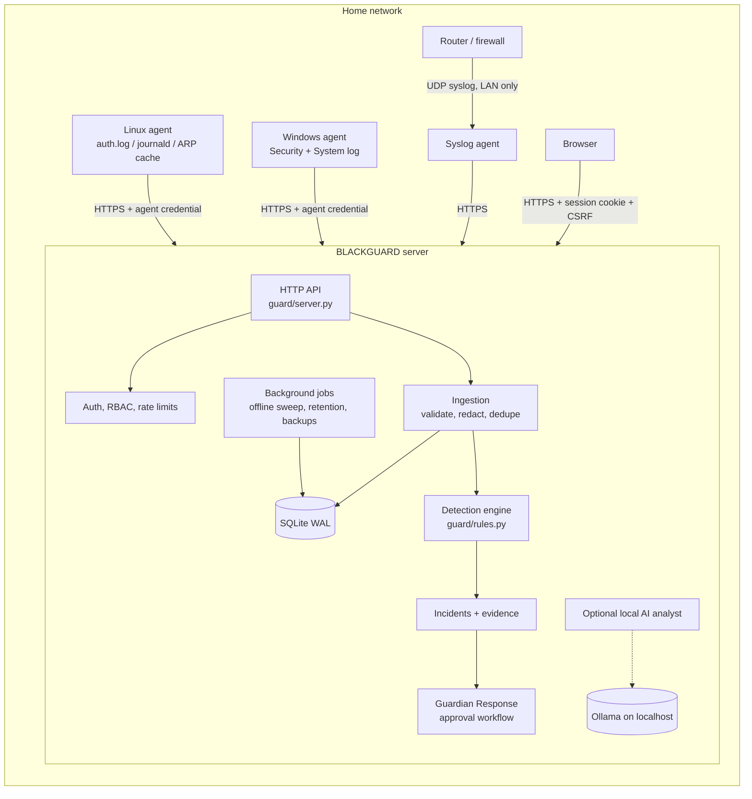

# Architecture

## Components

| Module | Responsibility |
| --- | --- |
| `guard/config.py` | Environment configuration with secure defaults. Refuses an insecure non-loopback bind |
| `guard/db.py`, `guard/migrations.py` | Thread-local SQLite connections (WAL), serialised write transactions, versioned migrations, online backup |
| `guard/security.py` | scrypt hashing, token generation and hashing, rate limiter, redaction, pseudonymisation |
| `guard/auth.py` | Users, roles and permissions, sessions, lockout, first-run setup |
| `guard/agents.py` | Enrollment codes, approval, credentials, rotation, revocation, heartbeat and health, offline sweep |
| `guard/events.py` | Event taxonomy, validation, idempotent ingestion, search, histograms |
| `guard/inventory.py` | Devices and attribute provenance, ARP/DHCP observations |
| `guard/rules.py`, `guard/detection.py` | Rule definitions; the engine that evaluates them and persists incidents |
| `guard/incidents.py` | Incident queries, notes, status workflow, timelines |
| `guard/response.py` | Response action catalogue, approval state machine, integration interface |
| `guard/reports.py`, `guard/ai.py` | Exports; the optional AI analyst |
| `guard/platform.py` | Application service wiring the pieces together; background jobs |
| `agents/bgagent/` | Cross-platform Python agent: sources, parsers, spool, client, runner, CLI |
| `agents/windows/BlackguardAgent.ps1` | Windows event-log agent speaking the same protocol |

## Data model (schema v2)

- **events**: `uid` (unique, the dedup key), `mode` (demo / imported / live), `trust` (verified_agent / legacy_token / manual_import / server / demo), source, type, host, IPs and port, actor, target, message (redacted), `details` (JSON), event time, received time, plus org/site/agent IDs.
- **incidents**: rule, `group_key`, severity, confidence and its reasoning, affected hosts, mode, status and its timestamps. Linked to events through **incident_events**. **incident_notes** holds human, system and AI notes.
- **agents**, **enrollment_invites**: identity, status (pending / active / suspended / revoked / legacy), credential hashes, fingerprints, health.
- **inventory**, **inventory_observations**: devices, plus the per-attribute history with source and confidence.
- **users**, **sessions**, **rule_settings**, **response_actions**, **audit_log** (hash chain), **settings**.
- **organizations** and **sites** exist from day one (default "Home" / "Home network"). Every event, agent and device carries `org_id` and `site_id`.

## Trust model

1. **Users** authenticate with passwords. Sessions are random 256-bit tokens, stored hashed. Permissions are checked per route. State-changing requests require a CSRF header and a same-origin `Origin`.
2. **Agents** authenticate with their own credential. The server ignores any identity claim in the body. Agents cannot reach dashboard routes, and session cookies cannot reach agent routes.
3. **Provenance** is recorded per event and shapes confidence. Unverified sources (manual import, the legacy token) lower confidence by one level unless a verified agent corroborates them.
4. **Server-generated notices** (offline, identity mismatch, data loss, new device) are stored as events with `trust=server`, so they are evidence like everything else.

## Detection execution

On ingest, the engine loads only the events inside `[min(new) − window, max(new) + window]` for rules whose event types are affected. Full sweeps cover 90 days. A finding is persisted only if it contains evidence not already linked to an incident of the same rule. That makes re-runs idempotent and lets resolution create a new incident instead of hiding fresh activity.

## Resource bounds

- Request bodies: 256 KiB (2 MiB for agent batches); 500 events per batch.
- Up to 32 concurrent requests by default (`BLACKGUARD_MAX_CONCURRENT`); 30-second socket timeouts; per-user, per-agent and per-IP token buckets.
- Agent spool capped at 100,000 events by default; overflow drops the oldest and is reported as data loss.
- Inventory observations are recorded only on change or hourly; retention trims events, observations and the audit log.

## Path to multi-site and business use

The schema already carries `org_id` and `site_id`, routes go through a permission layer, and agents are first-class principals. Planned steps, in order (see `ROADMAP.md`):

1. Site management UI, with agents and invites scoped to a site.
2. Organisation-scoped queries and per-org roles, enforced in the service layer.
3. A storage adapter so PostgreSQL can replace SQLite when write volume needs it. Queries are plain SQL with bound parameters and no SQLite-specific JSON functions on hot paths.
4. Centralised rule packs, exported and imported as versioned JSON.
5. Remote collectors behind mutual TLS, or a reverse tunnel, for sites without inbound connectivity.

None of this enterprise complexity is enabled for a single household.
