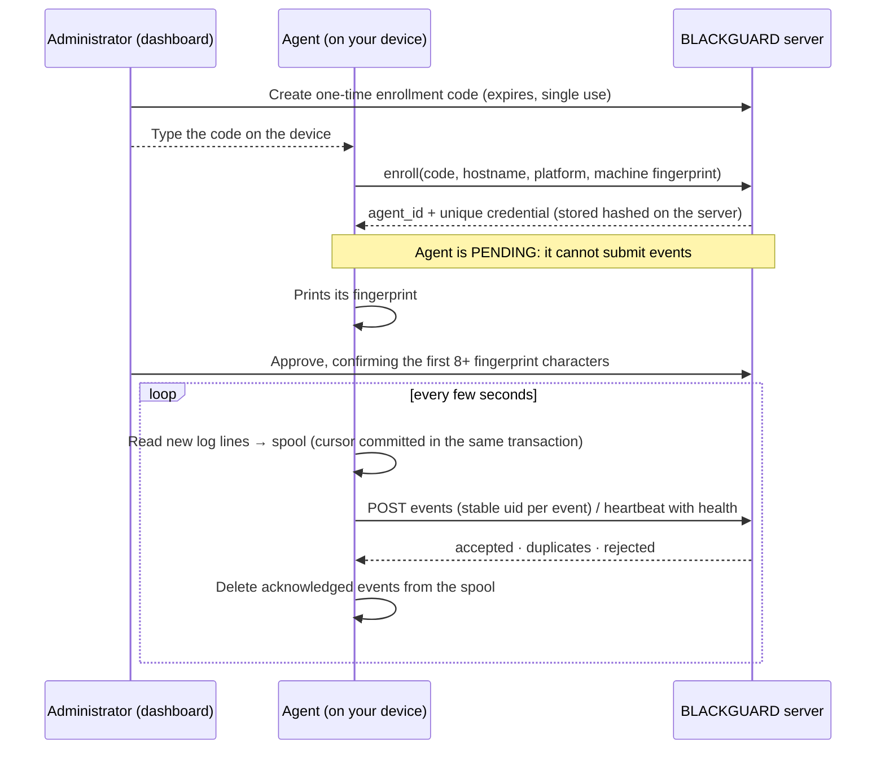
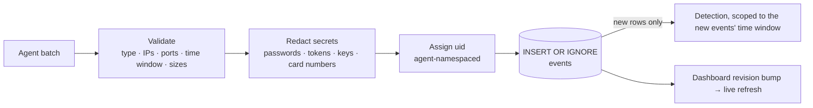
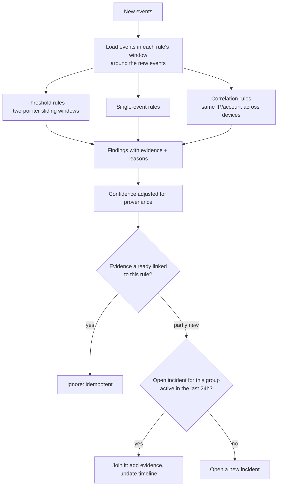
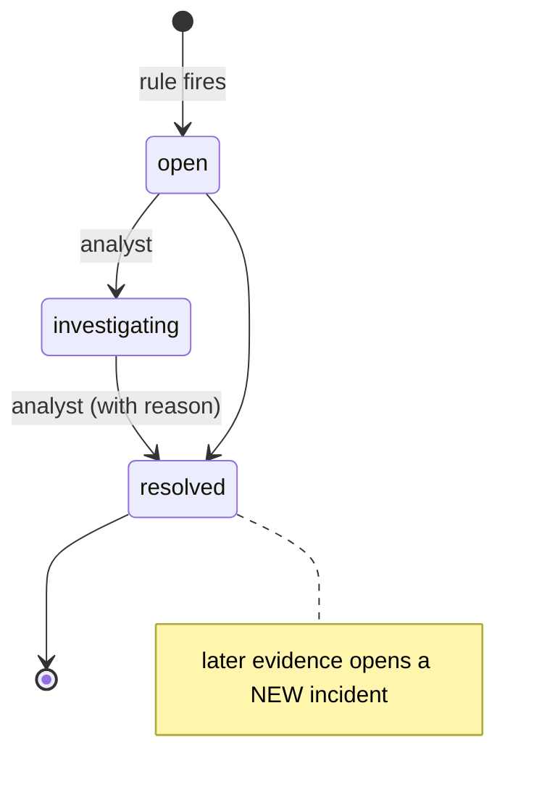
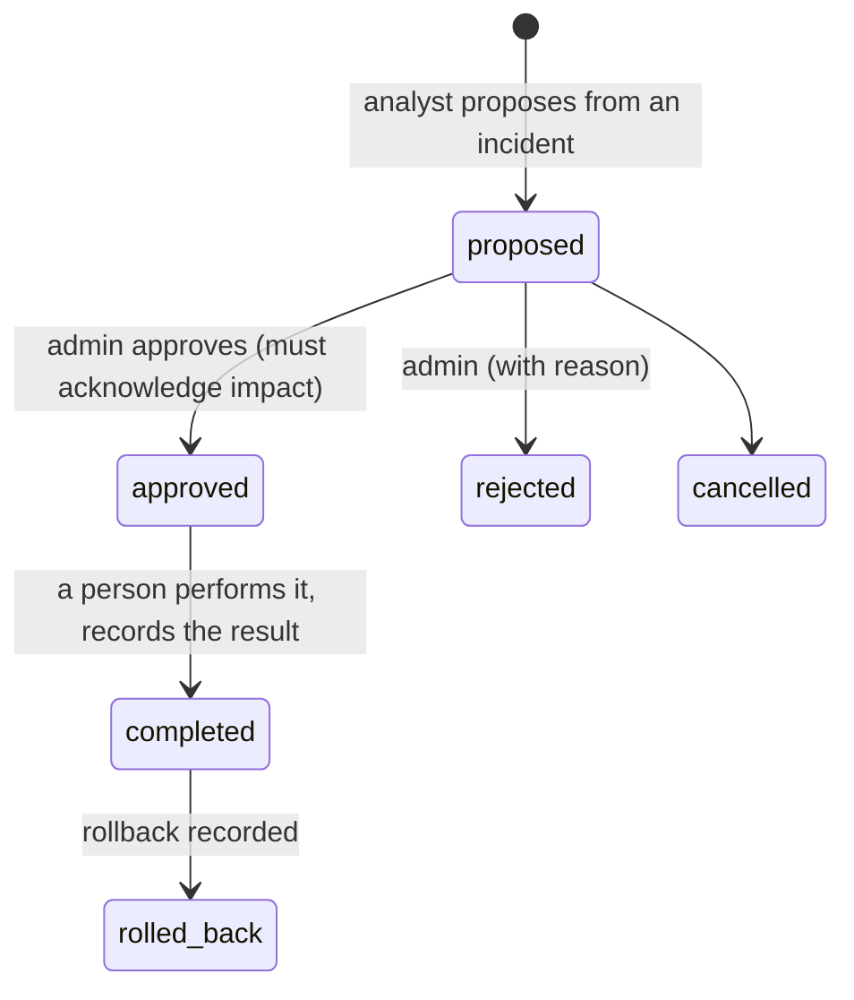

# How BLACKGUARD works

A guided tour of the five moving parts: **agents**, the **event pipeline**, **authentication**, the **detection engine**, and **incident management with Guardian Response**. File references point to the code that implements each step.

## 1. Agents: getting events off your devices

- **Sources** (`agents/bgagent/sources.py`, `agents/windows/BlackguardAgent.ps1`) read only what you configure: one log file, the systemd journal, a UDP syslog port that accepts only your router's IP, the Windows Security/System logs, or the agent's own ARP cache. Nothing is scanned.
- **Parsers** (`agents/bgagent/parsers.py`) are deliberately conservative: an unrecognised line returns *nothing* rather than a guess. Duplicate lines (PAM echoes, "Invalid user" pre-lines) are not double-counted.
- **The spool** (`agents/bgagent/spool.py`) is a small SQLite database on the device. Events and the file position that produced them commit atomically, so a crash never skips or re-reads a line.
- **Delivery** (`agents/bgagent/runner.py`) retries with exponential backoff and jitter. Because each event carries a stable `uid`, re-sending after a lost acknowledgement is harmless. If the spool fills during a very long outage, the oldest events are dropped **and reported**, which raises a *Collector dropped events* incident.
- **Identity**: the server works out who is sending from the credential alone. A fingerprint change suspends the agent and opens an incident. Credentials rotate in two phases, so a lost response never locks an agent out.

## 2. The event pipeline

Implemented in `guard/events.py` and `guard/platform.py:App.ingest`. Each stored event records two pieces of **provenance** that the UI and the detection engine both use:

| Field | Values | Meaning |
| --- | --- | --- |
| `mode` | `live` · `imported` · `demo` | Where the data belongs: real collection, a manual file import, or fictional training data |
| `trust` | `verified_agent` · `manual_import` · `legacy_token` · `server` · `demo` | How much BLACKGUARD can vouch for the source |

## 3. Authentication and authorisation

- **People** sign in with a username and password (scrypt). The server issues a random session token, stores only its hash, and sends it as an `HttpOnly; SameSite=Strict` cookie (`Secure` and `__Host-` prefixed under TLS). Sessions have idle and absolute timeouts.
- Every state-changing request needs the session's **CSRF token** in a header, and a same-origin `Origin`.
- Each route declares the **permission** it needs. Roles map to permission sets: *viewer* (read), *analyst* (investigate, import, export, propose responses), *admin* (everything, including approvals, agents, rules and users). The last active admin cannot be removed.
- **Agents** use a separate bearer credential. Agent routes and dashboard routes are disjoint.
- Login is rate-limited per IP, accounts lock after repeated failures, and every sign-in, change, export and decision is written to a **hash-chained audit log**.

Code: `guard/auth.py`, `guard/server.py` (`authorize`), `guard/audit.py`.

## 4. The detection engine

- Rules (`guard/rules.py`) are plain Python classes. Each declares an ID, ATT&CK techniques, tunable parameters, investigation steps and false-positive notes. Thresholds can be tuned from the dashboard, and every change is audited.
- **Confidence** starts at the rule's level. It rises when a threshold is exceeded three times over, and falls when no verified agent corroborates the evidence. The reasoning is stored in words on each incident.
- **Idempotency**: re-running a sweep never duplicates incidents. **Resolution semantics**: new evidence after an incident is resolved opens a *new* incident, so fresh activity is never hidden inside a closed one.
- **Validation**: unit tests for every rule, plus realistic attack, benign and router datasets (`tests/test_detection.py`). The benign dataset must raise no medium-or-higher findings.

## 5. Incidents and Guardian Response

The investigation workspace (`web/app.js`, `guard/incidents.py`) shows the evidence, a merged timeline of events, notes and status changes, affected devices with their inventory confidence, ATT&CK links, and the recommended responses. Each response carries an **impact statement** and a **rollback plan**. Guardian Response (`guard/response.py`) **never executes anything itself**. Future automated integrations (for example a router API that moves a device to a guest network) must implement the `Integration` interface and stay behind the same approval and audit workflow.

## 6. The interactive demo

`showcase/demo/` is the real dashboard code (`app.js`, `style.css`) plus `demo-api.js`, which answers API calls in the browser. Its data comes from `scripts/build_showcase.py`, which runs the **real server code** on a fictional household and records the real API responses. Investigation actions work in memory. Actions that need a server (enrollment, imports, backups) explain that rather than pretend. The page's Content-Security-Policy sets `connect-src 'none'`, so it cannot contact any backend.
